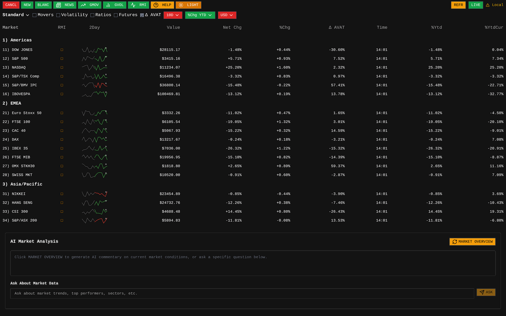
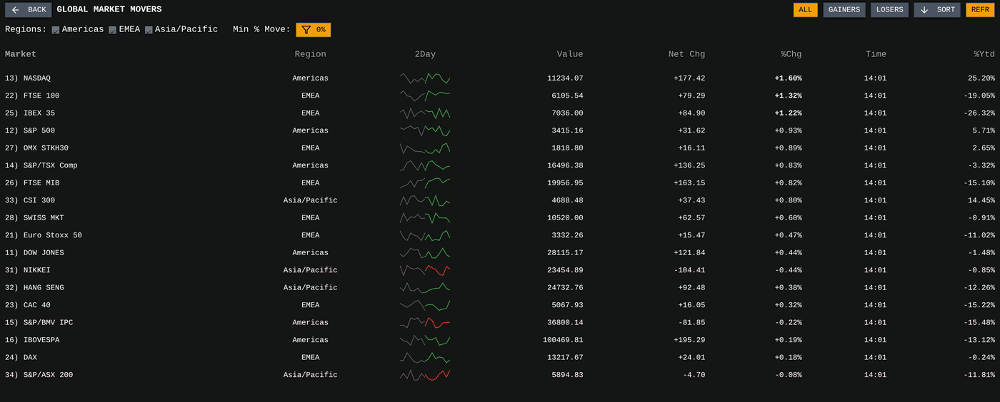
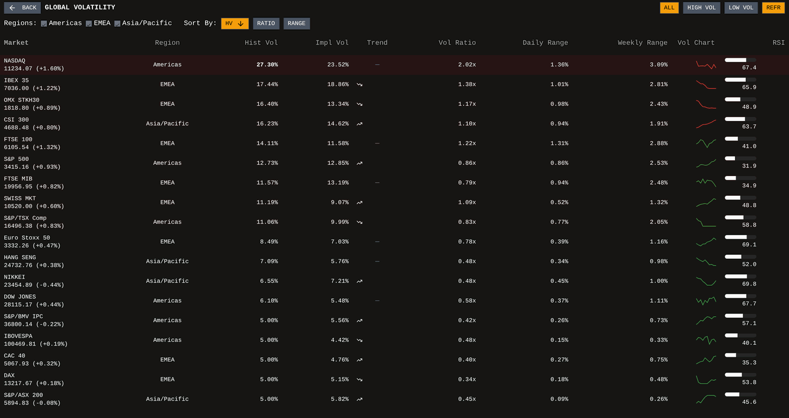
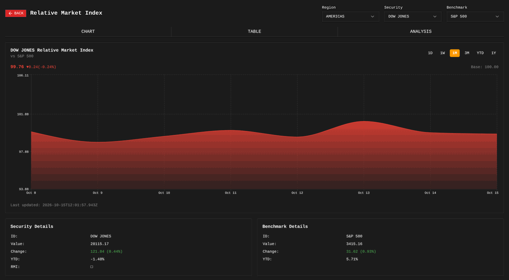
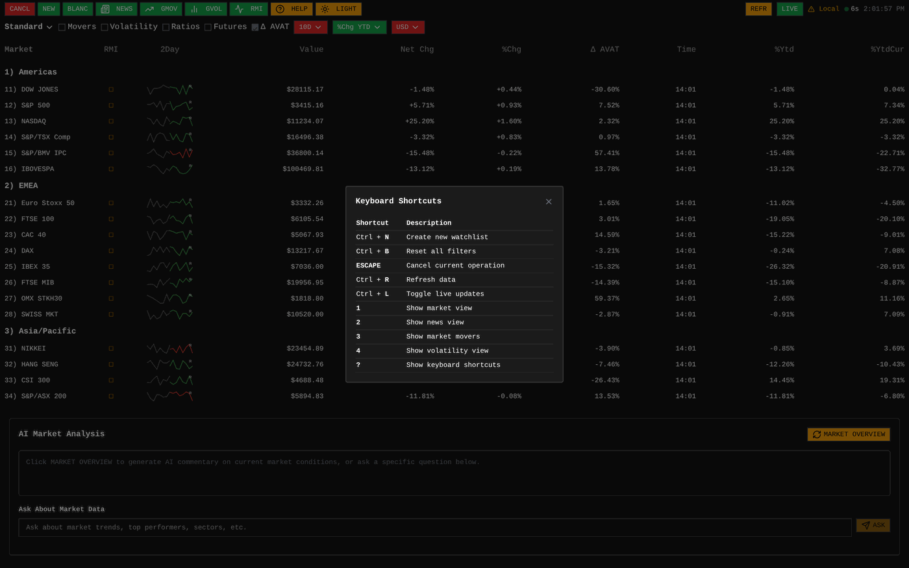

# Bloomberg Terminal + Claude

> **Fork of [feremabraz/bloomberg-terminal](https://github.com/feremabraz/bloomberg-terminal)**, a Bloomberg Terminal clone built with Next.js 15, React 19 and TypeScript. All credit for the original terminal goes to its author.
> This fork replaces the OpenAI integration with **Anthropic's Claude**, adds **four AI endpoints**, and fixes several bugs in the original views.


<sub>Screenshots taken locally with no API keys. Market values are the terminal's built-in **simulated data**, which it uses when Alpha Vantage and Redis are not configured.</sub>

---

## What you'll find in the terminal

### Market overview + AI Market Analysis
Global indices grouped by **Americas, EMEA and Asia/Pacific**, with value, net and % change, 2-day sparklines, Δ AVAT, YTD and YTD in USD. Values update live and changed cells flash.

At the bottom, the **AI Market Analysis** panel is powered by Claude:
- **MARKET OVERVIEW** writes a commentary on the data currently on screen.
- **Ask About Market Data** is a streaming chat (e.g. *"Which region is leading today and why?"*). Claude receives the live table as context.

The top bar holds the views (`NEWS`, `GMOV`, `GVOL`, `RMI`), a dark/light toggle, live updates and refresh.

### Global Market Movers (`GMOV`)

Every index ranked by the size of its move, filtered by region, gainers or losers, and a minimum % move.

### Global Volatility (`GVOL`)

Annualised historical vs implied volatility, vol ratio, daily and weekly range, a volatility sparkline and RSI, sortable by HV, ratio or range.

### Relative Market Index (`RMI`)

Shows how one index performs **relative to a benchmark**, rebased to 100 (e.g. Dow Jones vs S&P 500), with chart, table and analysis tabs and 1D to 1Y ranges.

### News (`NEWS`)
Financial news with sentiment from **Alpha Vantage**. Search by topic (`technology`, `earnings`, `economy_macro`…) or by ticker (`AAPL`). Needs `ALPHA_VANTAGE_API_KEY`.

### Keyboard shortcuts (`HELP` or `?`)


---

## AI endpoints added by this fork
All four use Claude through the official `@anthropic-ai/sdk` and share one guard (`app/api/ai/guard.ts`). The guard checks that the API key is configured, applies a **per-IP rate limit** (Upstash Redis, or in-memory when Redis isn't configured) and checks **allowed origins**. Inputs are validated with Zod.

| Endpoint | What it does | Hook |
|---|---|---|
| `POST /api/ai` | Streaming market chat with the live market table as context (used by the AI panel) | built into `ai-market-analysis.tsx` |
| `POST /api/ai/watchlist-analysis` | Briefing on a watchlist: top movers, correlations, risks, sentiment | `useWatchlistAnalysis` |
| `POST /api/ai/command` | Natural-language command → structured JSON, e.g. *"alert me if AAPL RSI < 30"* → `{intent, conditions, symbols, action}` | `useTerminalCommand` |
| `POST /api/ai/report` | Streaming reports: `market_summary`, `volatility`, `movers`, `sector` or `custom`, brief or detailed | `useReportGeneration` |

The three newer endpoints come with ready-to-use React hooks in `components/bloomberg/hooks/`. The current UI uses `/api/ai`. Wiring the hooks into new panels is a good next step.

Example:
```bash
curl -X POST http://localhost:3000/api/ai/command \
  -H "Content-Type: application/json" -H "Origin: http://localhost:3000" \
  -d '{"command":"alert me if AAPL RSI < 30"}'
```

## Fixes in this fork
- **News never loaded.** The browser called Alpha Vantage directly with a server-only key (`apikey=undefined`). It now goes through a server route (`/api/news`) that keeps the key private and maps searches to valid topics or tickers.
- **Asia/Pacific was missing** from Market Movers and Volatility, because the region filter compared `"asia/pacific"` with `"asiaPacific"`.
- **Historical volatility showed 5.00% for every index.** A daily % move was used as an annual volatility and hit the 5% floor. It is now annualised (×√252).
- **The RMI chart plunged to −88% or below zero.** It divided 0-to-1 sparkline shapes as if they were prices. They are now turned into price paths before the ratio is taken.
- **AI routes no longer require Redis** for local use (in-memory rate-limit fallback), and the main route no longer logs the API key's length.

## Quick start
Requires Node LTS and pnpm.
```bash
pnpm install
cp env.local.example .env.local      # Windows: copy env.local.example .env.local
pnpm dev                             # http://localhost:3000
```
The terminal runs **without any keys** using simulated market data. Add keys to enable each feature:

| Variable | Needed for |
|---|---|
| `ANTHROPIC_API_KEY` | AI panel and all `/api/ai/*` endpoints ([console.anthropic.com](https://console.anthropic.com)) |
| `ALPHA_VANTAGE_API_KEY` | News and real market quotes ([alphavantage.co](https://www.alphavantage.co/support/#api-key)) |
| `UPSTASH_REDIS_REST_URL` / `_TOKEN` | Cached market data and shared rate limiting (optional locally) |
| `ALLOWED_ORIGINS` | Origins allowed to call the AI endpoints. Defaults to `http://localhost:3000`. Add your URL if you deploy |

This repository contains **no API keys**. `.env` and `.env.local` are in `.gitignore`.

## Tech stack
Next.js 15 (App Router) · React 19 · TypeScript · Tailwind CSS · shadcn/ui · Jotai · TanStack Query · Recharts · Upstash Redis · Anthropic Claude API · Zod · Biome

## License
The original project is MIT-licensed. This fork keeps the same license.

**Fork maintained by:** Rodrigo Chemite Barbosa · [github.com/ch3m1bb5](https://github.com/ch3m1bb5)
